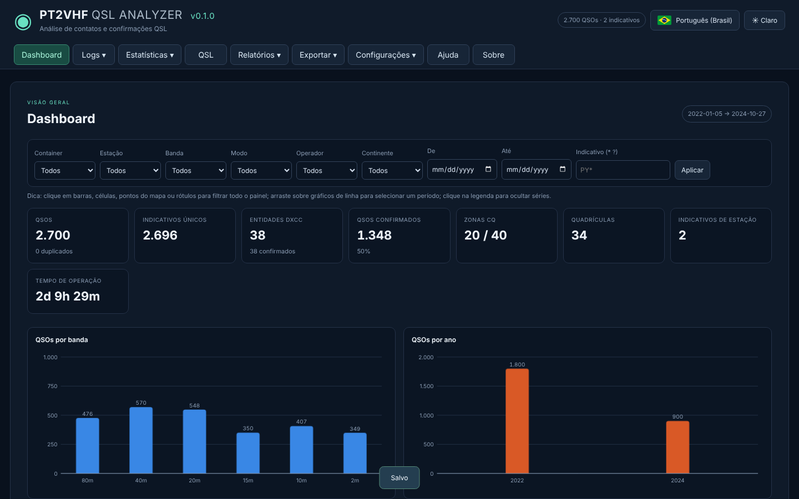
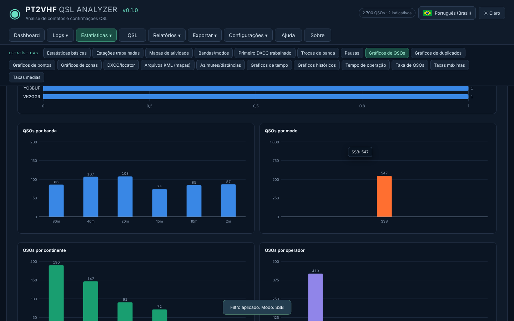
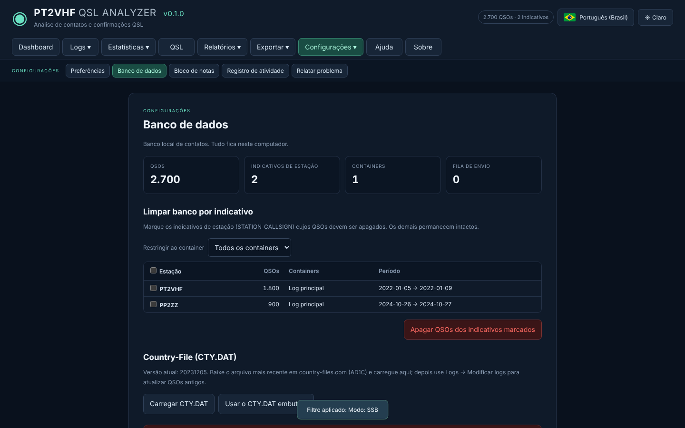
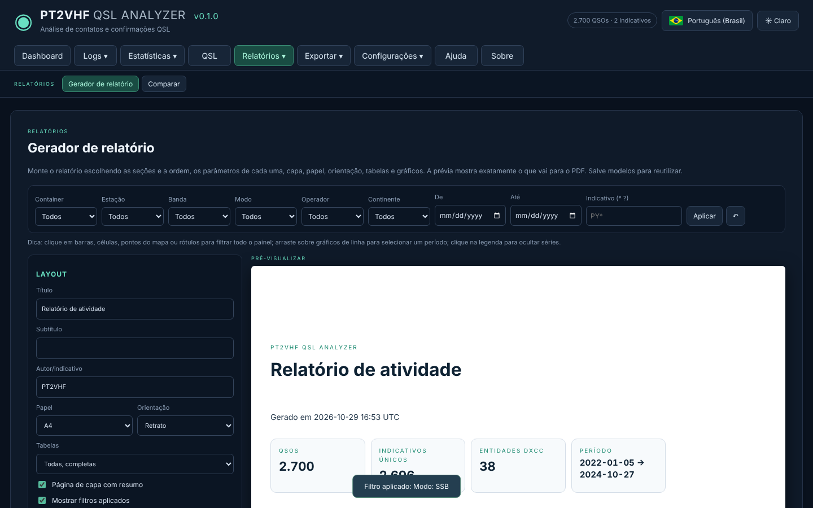

# PT2VHF QSL Analyzer

Aplicativo para **Windows, Linux e macOS** que **analisa os contatos de radioamador** a partir de logs ADIF e de outros formatos conhecidos, guarda tudo num **banco local** e gera estatísticas, mapas, status de QSL e relatórios em PDF. Ele cobre todos os recursos do [QScope.org](https://www.qscope.org), mas roda offline, no seu computador.

[Notas da versão](CHANGELOG.md) · [Backlog](BACKLOG.md) · [Relatar problema ou sugestão](https://github.com/alexpmr/QSL-Analyzer/issues)



## O que funciona

- **Banco local incremental.** Você pode enviar novos logs quantas vezes quiser: só entram os QSOs que ainda não existem. Um QSO é considerado existente quando a estação, o indicativo, a banda, o grupo de modo e o minuto (com tolerância de ±1 min) coincidem no mesmo container. QSOs já existentes têm as confirmações QSL (papel, LoTW, eQSL) e os campos vazios atualizados.
- **Vários indicativos de estação.** Cada QSO guarda o seu `STATION_CALLSIGN`. Se você enviar dois ADIFs de duas estações diferentes, em **Configurações → Banco de dados** pode apagar só o indicativo que quiser, em todos os containers ou em um só.
- **Formatos:** ADIF 2/3 (.adi), ADX (XML), Cabrillo 2/3, EDI REG1TEST (concursos VHF/UHF) e CSV com cabeçalho. Um ADIF também pode ser colado direto na tela.
- **Plataformas online:** baixa e importa direto do **QRZ.com Logbook** (chave de API), do **ARRL LoTW** (confirmações), do **eQSL.cc** (Inbox) e do **Club Log**. As credenciais só ficam guardadas se você pedir, criptografadas pelo Windows.
- **Menu Logs**, no mesmo fluxo do QScope: 1→ Gerenciar containers · 2→ Enviar logs · 3→ Importar logs · 4→ Modificar logs (atualizar DXCC/zonas pelo CTY.DAT, corrigir banda pela frequência, renomear modos, definir estação/operador, mover) · 5→ Copiar/filtrar logs · Busca no log (curingas `*` e `?`) · Importar de plataformas.
- **Menu Estatísticas** com as 20 análises do QScope: Estatísticas básicas, Estações trabalhadas, Mapas de atividade, Bandas/modos, Primeiro DXCC trabalhado, Trocas de banda, Pausas, Gráficos de QSOs, de duplicados, de pontos e de zonas, DXCC/locator, Arquivos KML (mapas), Azimutes/distâncias, Gráficos de tempo, Gráficos históricos, Tempo de operação, Taxa de QSOs, Taxas máximas e Taxas médias.
- **Aba QSL:** confirmações por papel, LoTW e eQSL e matriz **DXCC × banda** trabalhado (W) / confirmado (C).
- **Gráficos interativos no estilo BI.** Clique numa barra, célula, ponto do mapa ou rótulo para filtrar a tela inteira, arraste sobre um gráfico de linha para escolher um período e clique na legenda para ligar ou desligar séries. Os filtros se aplicam na hora e aparecem como chips removíveis, com botão de desfazer. Gráficos animados com dicas ao passar o mouse.
- **Relatórios:** gerador personalizável. Você escolhe as seções, a ordem, os parâmetros de cada uma, a capa, o papel (A4/Carta/Ofício/A3), a orientação, as tabelas (todas, só a principal ou nenhuma), os gráficos, a quebra de página por seção, cores claras para impressão e o rodapé. A prévia mostra exatamente o que vai para o **PDF**, que também pode sair em HTML. Os modelos podem ser salvos. Há ainda a aba **Comparar** para ver containers ou indicativos lado a lado.
- **Exportação:** ADIF v3, CSV, Cabrillo 3.0 e KML/Google Earth (entidades, quadrículas, linhas de QSO e replay temporal). Cada página de estatística exporta CSV, TXT, PNG e PDF. Também há backup e restauração completos do banco. A exportação e o backup ficam no menu **Logs**.
- **Configurações:** preferências (indicativo, quadrícula, pausa padrão, regra de pontos, cores dos gráficos e tema), banco de dados (limpeza por indicativo, CTY.DAT atualizável e reinício de fábrica), bloco de notas, registro de atividade e relatório de problemas.
- Interface em português, inglês e espanhol, com tema escuro ou claro.

| Estatísticas com filtro por clique | Limpeza do banco por indicativo |
|---|---|
|  |  |



## Downloads

Downloads, novas versões e atualizações são distribuídos **somente pelo site oficial**: **[www.pt2vhf.com/qsl](https://www.pt2vhf.com/qsl)**.

| Sistema | Pacote |
|---|---|
| Windows 10/11 x64 | Instalador (.exe) ou portátil (.exe, sem instalação) |
| Linux x64 | AppImage, .deb (Ubuntu/Debian/Mint) ou .tar.gz |
| macOS | .dmg para Apple Silicon (arm64) e Intel (x64) |

No macOS o aplicativo ainda não é assinado pela Apple: na primeira abertura, clique com o botão direito no app e escolha **Abrir**. Se aparecer a mensagem "está danificado", rode `xattr -cr "/Applications/PT2VHF QSL Analyzer.app"` no Terminal.

A cada abertura, o aplicativo lembra que o site oficial é www.pt2vhf.com. Em seguida, consulta `www.pt2vhf.com/update.php` e avisa quando há uma versão nova.

## Instalar e começar

1. Baixe o pacote do seu sistema em [www.pt2vhf.com/qsl](https://www.pt2vhf.com/qsl).
2. Em **Configurações → Preferências**, informe o seu indicativo e a sua quadrícula (usada nas distâncias e azimutes).
3. Em **Logs → Enviar logs**, arraste os arquivos. Depois, em **Logs → Importar logs**, escolha o container e importe. Outra opção é usar **Logs → Importar de plataformas**.
4. Explore o **Dashboard**, as **Estatísticas** e a aba **QSL**, e monte o seu relatório em **Relatórios**.

Na versão instalada, os dados ficam na pasta de dados do usuário (no Windows, `%APPDATA%\PT2VHF QSL Analyzer`; no Linux, `~/.config/PT2VHF QSL Analyzer`; no macOS, `~/Library/Application Support/PT2VHF QSL Analyzer`). Na portátil do Windows, ficam na pasta `data` ao lado do executável. O banco é um arquivo JSON gravado de forma atômica, e a versão anterior é mantida como `.bak`.

## Desenvolvimento

```bash
npm ci
```

```bash
npm start
```

```bash
npm run check
```

```bash
npm test
```

Para ver a prévia no navegador, rode `npm run preview` e abra `http://127.0.0.1:8094/ui/`. Nesse modo o banco fica no IndexedDB, e as plataformas online só funcionam no aplicativo desktop.

Estrutura: `src/` tem o núcleo sem dependências (leitores, banco, estatísticas, exportação, plataformas, i18n), `ui/` a interface (HTML/CSS/ES modules, gráficos SVG próprios) e `desktop/` o processo principal do Electron. O workflow `.github/workflows/release.yml` valida o código, faz o smoke test e gera os pacotes de Windows, Linux e macOS. Na `main`, ele cria a release do GitHub, que serve apenas de origem dos arquivos publicados em www.pt2vhf.com.

## Créditos

Country-Files CTY.DAT de Jim Reisert AD1C, tabela DXCC [k0swe/dxcc-json](https://github.com/k0swe/dxcc-json), mapa Natural Earth. Inspirado no QScope, de Yannick Devos ZL4YY. Desenvolvido por Alex Rodrigues, PT2VHF.
